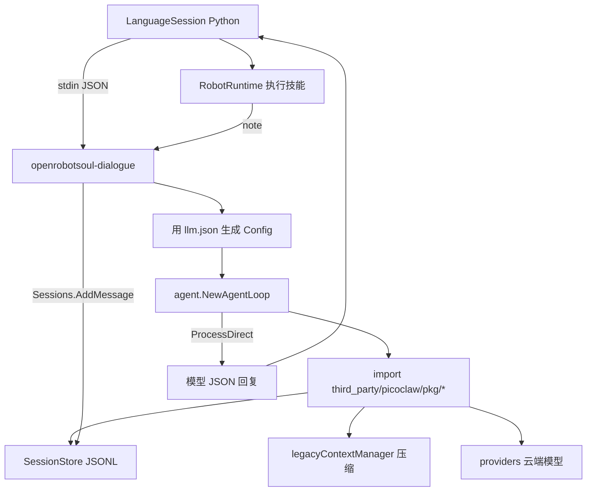

# 对话上下文与 PicoClaw AgentLoop

状态：已审核方案（待实现）  
关联：[Agent 选型与 PicoClaw 集成决策](11-agent-tooling-decision.md)

## 问题

当前自然语言决策每次只发两条新消息（系统提示 + 本句），没有上一轮用户原话或拒绝理由。语音里的「回复结束，等待后续指令」只重新打开跟进窗口，不清也不传对话历史。因此像「向后转一百八十度」被拒绝后，下一句「那就分两段转」模型仍然看不到上文。

## 结论

用常驻的 `openrobotsoul-dialogue` 接管自然语言决策的上下文：同一入口的多轮对话写入持久 session，并使用 `third_party/picoclaw` 自带的摘要和紧急压缩。技能仍只由 Python 运行时执行，对话进程不打开任何工具。

编码任务仍走现有 `robotsoul/picoclaw.py` 起的 `picoclaw` 二进制。对话任务不走那条 CLI，也不改子模块源码。

## 怎么接到 `third_party/picoclaw`

仓库根新增独立 Go 模块 `cmd/openrobotsoul-dialogue/`，`go.mod` 写：

```go
module github.com/openrobotsoul/dialogue

require github.com/sipeed/picoclaw v0.0.0

replace github.com/sipeed/picoclaw => ../../third_party/picoclaw
```

构建时 `go build` 这个模块，产物进 `build/<platform>-<arch>/bin/openrobotsoul-dialogue`（与现有 `robotsoul/build.py` 的 PicoClaw 编码二进制并列）。Python 常驻拉起的是这个新二进制，不是 `third_party/picoclaw/cmd/picoclaw`。

直接 import 子模块里的这些包（不改它们的文件）：

| 用途 | 包路径（均在 `third_party/picoclaw/`） |
| --- | --- |
| 对话主循环 | `pkg/agent` → `NewAgentLoop`、`ProcessDirect`、`Close` |
| Session 读写与落盘 | `pkg/session` / `pkg/memory`（经 AgentInstance 的 `Sessions`） |
| 上下文组装与摘要注入 | `pkg/agent` → `ContextBuilder.BuildMessages`、`legacyContextManager` |
| 摘要与紧急压缩 | `pkg/agent/context_legacy.go` → `maybeSummarize`、`forceCompression` |
| 模型调用 | `pkg/providers` → `CreateProvider` |
| 配置结构 | `pkg/config` → `Config`、`AgentDefaults`、`ToolsConfig` |
| 消息总线（构造 AgentLoop 需要） | `pkg/bus` → `NewMessageBus` |

不接入、不启动的部分：

- `cmd/picoclaw` 的 CLI / Gateway / 聊天渠道
- 子模块默认打开的工具注册（`exec`、`write_file`、`web`、`spawn` 等）
- `~/.picoclaw/config.json`（对话用 `config/llm.json` 生成临时配置）
- 编码用的一次性 `picoclaw agent --message`（继续只服务 coding）



`decide` 时调用的就是子模块已有 API：

```go
response, err := agentLoop.ProcessDirect(ctx, userText, sessionKey)
```

这一步会：读该 session 的历史与 Summary → `BuildMessages` → 调模型 → 把本轮 user/assistant 写入 JSONL → 回合结束后走 `Compact(summarize)`。OpenRobotSoul **不自己实现**上下文压缩，只关掉工具并固定 session key。

## 对话进程

协议仍是一行一个 JSON，由 `robotsoul/language_session.py` 把启动命令从 `python -m robotsoul.language_gateway` 换成上述二进制，退出时关掉。

启动时用 `config/llm.json` 生成一份只给对话用的 PicoClaw `config.Config`，不读取 `~/.picoclaw/config.json`：

- 模型、地址、密钥、超时来自现有 `llm.json`
- `temperature` 为 0，`max_tokens` 为 1024，`context_window` 为 32000
- 压缩沿用子模块默认：`summarize_message_threshold=20`，`summarize_token_percent=75`；超窗口时 `forceCompression` 丢掉最老完整回合。Summary 由 `SetSummary` 保存，下一轮 `BuildMessages` 注入系统提示
- 在生成的 `ToolsConfig` 里把 `exec`、`read_file`、`write_file`、`web`、`spawn`、`mcp` 等全部 `Enabled=false`；hooks、evolution、heartbeat 关闭；`max_tool_iterations=1`。模型若返回工具调用，这一轮直接拒绝，不执行

工作区放在 `~/.openrobotsoul/dialogue`（写入 `AgentDefaults.Workspace`），session 落在其中 `sessions/`，对应子模块 `NewAgentInstance` 里的 `filepath.Join(workspace, "sessions")`。这里只放对话，不放编码工作区。

三类请求：

- `decide`：只把本句用户原话交给 `ProcessDirect(sessionKey)`。技能表、身份和传感器写入工作区引导文件（子模块 `LoadBootstrapFiles` / `IDENTITY.md` 一类路径），进入系统提示，不进入历史。压缩掉的是对话，不是反复出现的技能 schema
- `note`：任务结束后对同一 session 调 `Sessions.AddMessage`，追加助手侧结果，例如「未执行：没有精确的一百八十度动作」。不再请求模型
- `review`：安全复核仍无历史、无工具，直接走 `providers`，不写入 voice/dashboard session

模型输出仍是现在的 JSON：一个技能、一个计划、拒绝，或 `coding_task`。解析可留在 Go 侧或现有 Python 校验路径；运行时的 schema、风险和确认逻辑不变。**不修改** `third_party/picoclaw` 内任何源文件；子模块保持锁定提交，构建校验继续要求干净。

## 会话怎么分

跟进窗口到期只停止收音，不清 session。session 落在磁盘上，进程重启后还在。

按入口分开，避免面板文字和现场语音串在一起：

- 本地语音：`voice`
- 通话：`call`
- Dashboard 文本和 CLI：`dashboard`

`robotsoul/runtime.py` 的 `run_text` 增加 session 参数。`robotsoul/voice/factory.py` 按当前采集来源传入 `voice` 或 `call`。`robotsoul/dashboard.py` 传入 `dashboard`。

闭集命令和 `/技能` 不经过模型，也要 `note` 一句用户原话和执行结果，否则下一句自然语言看不到它们。模型自己做的决策已经由 `ProcessDirect` 写入原话和 JSON 回复，结束后只补执行结果。

## 不改的边界

- 对话进程不能改文件、跑 shell、发网络工具或直接驱动机器人
- 编码进程仍是一次性的，session 每次新建，临时 home 仍会删掉
- 高风险技能仍不能靠自然语言执行
- 自然语言决策由这个无工具的 PicoClaw AgentLoop 持有上下文；它仍不执行技能

## 实现待办

1. 新增无工具的常驻 Go 对话进程，接入 AgentLoop 的 session 与 legacy 压缩
2. 按 voice、call、dashboard 传递 session，决策后追加执行结果且不再调模型
3. 技能 JSON 仍经现有校验路径处理，运行时安全复核保持原边界
4. 补 session、note 和工具全关测试（规划文档已同步更新）

## 测试

- 现有语言会话测试继续用假进程，断言 `decide` 带上 session，失败或成功后多一条 `note`，`review` 不带对话历史
- 生成配置的测试断言所有工具和 hooks、evolution 都是关闭的
- 同一 session 连续两句时，第二句请求能看到第一句原话和拒绝理由；换 session 则看不到
