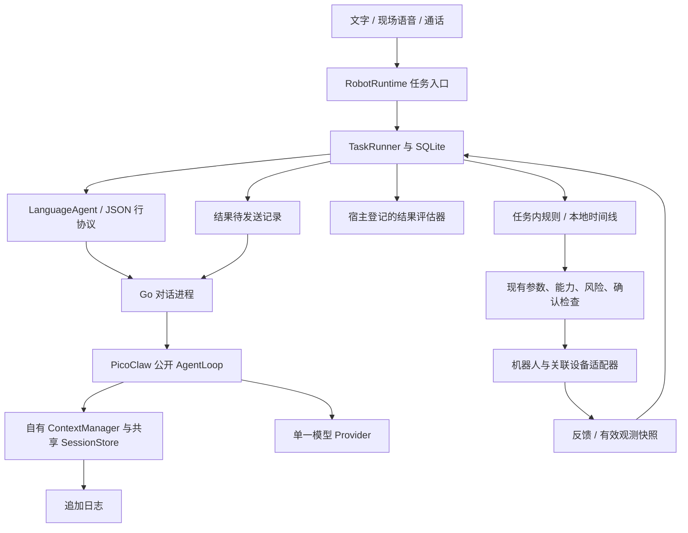

# 不修改 PicoClaw 源码的 Agent 运行底座

状态：首阶段已实现，按自动化与模拟验收。

实施日期：2026-11-14 至 2026-11-15。
依据：[可行性评估](19-agent-foundation-feasibility.md)。原方案保存在 [原始文档](evidence/18-original-dialogue-context-plan.md)，原探针及缺陷证据继续保留。

## 目标与范围

为文字、现场语音和通话提供能够保存上下文、组合技能、执行任务内规则、读取实际反馈并继续决策的 Agent 底座。机器人动作由 Python 宿主派发；常驻 Go 对话进程负责模型决策与持久对话。

首阶段用模拟技能验收“按音频节拍闪灯”和“去阳台检查窗户”。真实手机播放同步、导航、摄像头和窗户识别属于后续设备接入，不由此次测试推导实机效果。规则只在当前任务内运行，不提供长期自动任务。

PicoClaw 固定为 `bbf6893ca7afad27f1d00a0f5a45982a549c6ed6`，只更新主仓库 gitlink。所有新增实现均位于 RobotHarness，PicoClaw 子模块内不修改文件。独立 Go 模块直接引用该 checkout；新增直接依赖仅为已有 PicoClaw，Python 不新增依赖。

## 模块和职责



- `cmd/openrobotsoul-dialogue/`：独立 Go 进程、可靠上下文、无工具模型调用。
- `robotsoul/task_runner.py`：唯一任务回环，包含旧 `run_text()` 同步入口。
- `robotsoul/task_store.py`：SQLite 任务、决策、命令、反馈、恢复和结果待发送记录。
- `robotsoul/task_rules.py`：受约束规则与可注入单调时钟。
- `robotsoul/runtime.py`：现有动作安全检查与适配器执行，保持独立门禁。
- `robotsoul/language_session.py`：进程握手、协议转换、取消和配置变更后重启。
- Dashboard 与语音工厂：可信身份、任务查询、继续、取消和答复呈现。

## 可靠上下文

### 日志与事务

自有 SessionStore 和 ContextManager 共享一个追加式日志。每条持久记录包含唯一 ID、连续序号和 SHA-256 完整性校验，写入后同步磁盘。操作系统文件锁防止两个进程同时写入同一目录。

消息追加、历史恢复和摘要设置先写入请求的暂存视图，在 `Save` 中一次提交。ContextManager 的 `Ingest` 检查共享索引，不再次追加消息。原始日志首版不做物理删除。

重启时只恢复完整记录。半写尾部截断到最后完整提交；中部损坏或校验失败明确报错。重复请求返回已提交响应；请求已开始而响应未提交时返回 `request_interrupted`，不自动再次请求模型。结果事件按 session 与 `event_id` 去重，同 ID 不同内容报冲突。

### 摘要并发

后台摘要只选择已提交且已完成的整回合，保留最近回合和当前未完成回合。摘要快照记录会话代次、摘要版本与覆盖消息 ID；提交时全部核验，只移除摘要覆盖的可见前缀。

摘要生成期间追加的执行结果、新话轮继续保留。清空或恢复历史会更新代次，使旧摘要不能提交。摘要失败保留原文。完整提示超出上下文预算时明确拒绝，不静默截断必要历史。

执行结果 `note` 达到阈值后也会触发后台摘要。积压记录按完整回合和实际输入预算分批处理，每次压缩最多 64 批，并检查取消、会话代次和摘要版本是否推进；下一次决策可以等待后台工作后继续压缩。单次请求的必要内容本身过大时直接报错，避免反复摘要仍无法容纳。

宿主关闭时先取消并等待摘要任务，再关闭存储。摘要不承担设备时序控制。

### 接入检查

启动前创建受控 `AGENT.md`，声明 `tools: []`；隔离 PicoClaw home 与内置技能目录。使用配置关闭工具、MCP、hooks、自进化等入口，并检查 Agent 实际工具注册数为零。

通过公开接口注册自有 ContextManager，检查 Pipeline 实际选中该实例，再给 AgentInstance 注入共享 SessionStore。初始化失败禁止静默退回 legacy。

Provider 包装层在模型调用前、调用后及返回决策前检查存储健康和上下文完整性；拒绝非空工具声明、模型 ToolCalls、JSON 内意外工具调用、截断响应及超预算上下文。持久化失败时不向宿主释放动作决策。

模型请求中的任务上下文保留每个命令的终态反馈、证据和技能关联，去掉重复的接受/运行状态和工具审计副本；完整生命周期仍在 SQLite。对话输出预留 8192 tokens，以容纳最多 256 个时间线命令的证据 ID；完整输入和输出预留仍受 32768 tokens 窗口检查，必要事实过大时明确报错。

首版只使用一个 Provider；关闭 fallback 与流式决策。模型或机器人配置文件变化时，在下一次请求前关闭旧进程并重启，禁止原地热换 SessionStore。

## 身份与 JSON 行协议

`ConversationContext(robot_id, channel, principal_id, conversation_id)` 由宿主生成。规范 JSON 经 SHA-256 形成 `sk_v1_<64位十六进制>`，避免裸 `voice` / `call` 键被 PicoClaw 路由合并。不同用户、入口、机器人和对话分别隔离。

Dashboard 的 principal 来自认证账户，conversation 与认证 session 分开生成，不接受客户端冒充身份。同一账户重新登录也不自动合并。现场麦克风使用机器人上的本地会话；通话使用可信操作员与 call ID。CLI 默认新建对话，可显式指定 `--conversation-id`。

每个请求有唯一 `id`，协议版本为 1；stdout 只输出协议响应，诊断写 stderr。

| 请求 | 行为 |
| --- | --- |
| `hello` | 返回 ready、version、自有 manager 标识与 tools=0；Python 逐项检查 |
| `decide` | 记录用户原话或澄清答案，返回结构化决策 |
| `resume` | 以 source=runtime 包装反馈驱动的继续决策 |
| `note` | 持久追加执行结果；直接技能同时记录用户原话；event_id 去重 |
| `review` | 仅检查本次提案，不读写对话历史 |
| `clear` | 原子清空可见历史并使旧摘要失效 |
| `shutdown` | 等待后台任务并正常关闭 |

决策支持 `act`、`run_rule`、`wait`、`complete`、`clarify`、`reject`、`coding_task`；兼容旧 `skill`、`plan`、`rejected` 输出。编码转交在任务决定持久化后才进入已有隔离编码进程。

## 任务、动作与完成判断

### API

`RobotRuntime` 提供：

- `submit_task(text, conversation=..., task_id=..., goal_kind=..., expected_evaluator=...)`
- `get_task(task_id, conversation=...)`
- `resume_task(task_id, text=... / event=..., event_id=..., conversation=...)`
- `cancel_task(task_id, conversation=...)`
- `wait_task(task_id)` 与兼容同步入口 `run_text()`
- `register_result_evaluator(name, evaluator, description=...)`

异步提交的同一 task_id 和同一请求返回原任务；改内容、身份、执行权限或目标契约报冲突。同步兼容入口仍拒绝复用已使用的 task_id。

`TaskContext` 包含原始目标、状态、有效观测、反馈、历史、决策次数、澄清答案、可用评估器及宿主目标契约。结果有独立 `reply`；问题和普通答复不作为动作失败。

新增等待事件、等待用户、请求取消和执行中断状态。每次技能结束先持久保存结果，再决定是否继续请求 Agent。旧顺序计划作为固定计划执行，但同样经过任务存储和安全检查。

### 完成契约

设备目标接入时，宿主使用 `goal_kind="physical"`，并为领域目标指定 `expected_evaluator`。模型不能改写这个要求，也不能在零命令、无当前任务证据时宣告物理目标完成。

评估器由可信代码登记；引用的反馈必须属于当前任务、trace 和已登记命令。默认技能评估器检查所有命令，不能拿一条成功覆盖先前未消解的失败。通用纯对话的完成表示答复已生成；领域物理效果必须由相应评估器证实。

窗户场景将“检查已完成”与 `open / closed / unknown` 分开；打开与关闭都可以完成检查，unknown 有界补看后需要澄清。名义时长动作继续说明身体完成为估计，不升级为实测结果。

### 规则和预算

注册模板仅有 `sequence`、`if_result`、`wait_event`、`retry_limited`、`timeline`。执行前验证整棵规则，模型不能提供脚本或表达式。条件仅比较受约束结果字段。每台机器人使用一个任务工作队列，关联设备动作由该任务的本地调度器派发。

默认每任务 8 次 Agent 决策、32 个普通技能命令、300 秒；时间线累计最多 256 个事件。规则提前校验预算，不能靠拆成多个规则绕过。

真实时钟路径设独立截止计时器，能够在阻塞的模型、动作或编码调用期间请求停止。截止状态先持久化，晚到结果不能将任务改为完成；未确定动作结果时保持 interrupted。注入的模拟时钟在本地调度检查同一预算。

时间线使用可注入单调时钟，支持 pause、resume、seek、end 和 cancel；迟到事件跳过，不集中补发，也不重放已派发事件。模型调用次数不随节拍数量增长。

物理动作默认不重试。仅 profile 与适配器都明确登记 `retry_safe`，且结果确定失败时，`retry_limited` 才可最多尝试 3 次。超时、未知结果与设备不确定错误立即中断，不请求模型擅自重发。

### 持久化和停止

命令记录在 `adapter.execute` 之前写入 SQLite；写入失败不执行。重启后非终态任务标为 interrupted，未取得有效终态的命令标为 unknown，不自动重发；命令反馈与任务快照之间的崩溃也能恢复已保存的反馈。

任务取消先保存独立标记并置本地信号；模型等待和事件等待可以立即结束。对应模型或安全复核请求可被中断，下一请求重启对话进程；不等待模型批准取消。活动动作仍由适配器确认停止。无法确定动作结果时标 interrupted，后续步骤不启动。

观测统一采集并验证机器人身份、时间、TTL、隐私和 event ID。事件去重与有效状态快照分开：重复事件不再次接收，但仍有效的事实继续提供给后续决策。

执行结果和待发送 note 同事务保存。note 失败只补交对话结果，不再次执行技能。

## Dashboard、语音与运行

Dashboard 接口：

- `POST /api/tasks`：默认同步兼容；`async: true` 返回 202；可传 request_id。
- `GET /api/tasks/<id>`：查询同一可信对话的进度与 reply。
- `POST /api/tasks/<id>/resume`：同一对话补充 text，可传 event_id 去重。
- `POST /api/tasks/<id>/cancel`：立即请求取消。
- 现有直接技能按钮继续经过提案、确认与安全检查，同时记录原话和结果。

界面显示进度、最终答复、待补充问题及取消按钮。语音优先播报 reply；同一对话等待澄清时续接原 task_id，其他新语句维持替换语义。继续任务的取消绑定实际 task_id；本地麦克风和通话分开。

生产 CLI 默认任务库 `~/.openrobotsoul/tasks.sqlite3`，可用 `--task-store` 或 `OPENROBOTSOUL_TASK_STORE` 覆盖。库 API 默认 `:memory:` 适合测试，持久部署应显式指定 task_store_path。

对话数据默认 `~/.openrobotsoul/dialogue`，可用 `OPENROBOTSOUL_DIALOGUE_HOME` 覆盖。二进制可用 `OPENROBOTSOUL_DIALOGUE_BINARY` 指定；缺失时给出构建错误，不退回旧无状态 Python gateway。

## 构建与验收

```powershell
python -m robotsoul.build --dialogue-only --platform windows --arch amd64
python -m robotsoul.build --dialogue-only --platform linux --arch amd64
python -m robotsoul.build --dialogue-only --platform linux --arch arm64
python -m unittest discover -s tests
```

Go 模块内执行：

```powershell
go test -mod=readonly -count=1 ./...
go vet -mod=readonly ./...
```

构建接受 amd64/arm64 别名，目录规范化为 x86_64/aarch64。产物在 `build/<platform>-<arch>/bin/`，独立清单为 dialogue-manifest.json；使用 CGO_ENABLED=0、goolm/stdjson 和只读模块构建。

验收覆盖：摘要追加/清空/恢复并发、半写日志、损坏、存储故障、请求重放、重启、工具隔离；窗户 open/closed/unknown 与导航失败；128 节拍固定模型调用次数、暂停/跳转/取消；任务/事件/身份去重、模型与动作等待取消、语音澄清续接和原安全兼容测试。

最新运行证据见 [实施验收记录](20-agent-foundation-implementation.md)。实机同步精度、导航成功率和视觉识别效果留待设备接入阶段验收。
