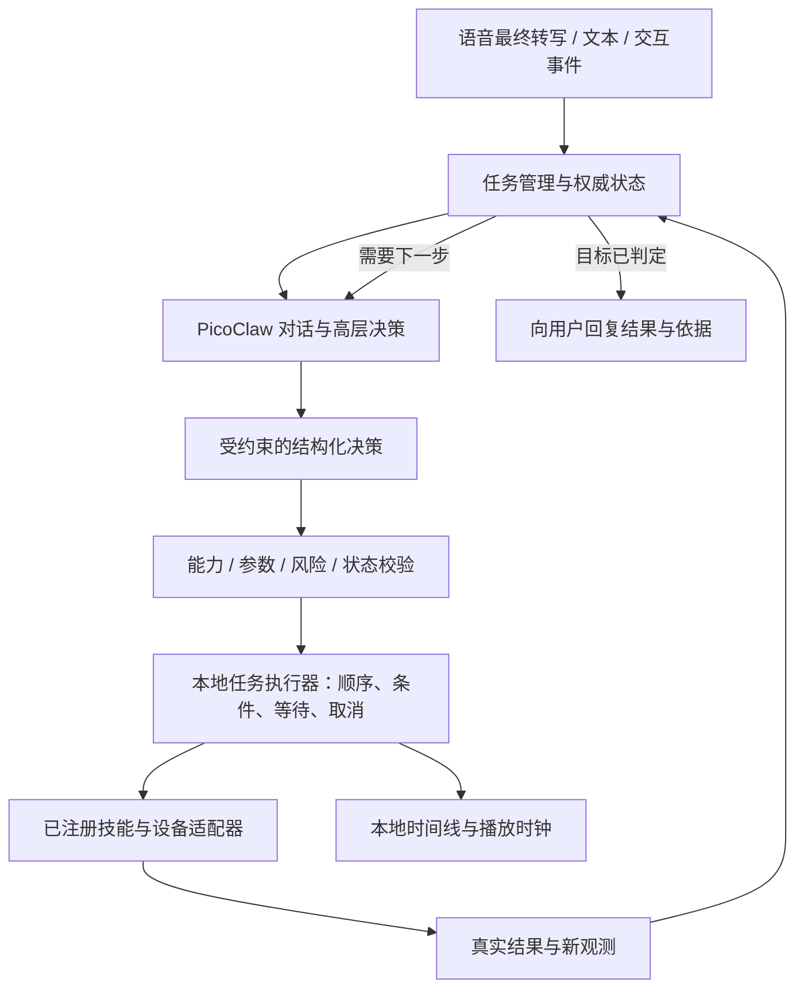

# 对话方案与 Agent 运行底座可行性评估

评估日期：2026-11-14（Asia/Shanghai）  
评估对象：[18：对话上下文与 PicoClaw AgentLoop](18-picoclaw-dialogue-context.md)  
性质：方案评估与实施建议；本文及验证附件不代表运行时功能已经实现。

## 1. 结论与目标对齐

**方向可行，但 18 号方案不能原样作为完整 Agent 底座验收。** 它能解决“记住前面说过什么”，还需要补齐“维护任务目标、根据执行反馈决定下一步、按本地规则与时间线调度动作”。这与用户提出的两个例子直接相关：

| 目标 | 可行性判断 | 实际需要的底层能力 |
| --- | --- | --- |
| 语音、文字等入口共享 Agent 能力 | 可行，已有统一入口和本地技能校验基础 | 正确的会话分区、任务关联、上下文和结构化决策 |
| 组合动作、按规则选择动作 | 可行，当前只实现了有限顺序计划 | 持久任务状态、逐步反馈、条件与事件、有限重试、取消和资源协调 |
| 手机闪光灯跟播放音频的节拍闪烁 | 有明确工程路线，尚未实机证明 | 音频分析、播放时钟、本地时间线执行器、灯光驱动 |
| 去阳台确认窗户是否打开 | 有条件可行，硬件与场地依赖更强 | 已验证导航、目标位置、相机、窗户状态识别、观测驱动的后续决策 |

建议将本次建设的目标明确为：

> 用户通过语音或其他入口提出目标；Agent 根据当前能力和有效观测产生受约束的决策；本地运行时组合与调度技能；真实反馈更新同一个任务，必要时再次规划，直到完成、取消、失败或需要用户补充信息。

PicoClaw 可以承担模型、会话和上下文管理。**完整任务的所有权和动作执行回环由 Python 运行时承担**；音频同步、运动控制和设备停止在本地完成。不要求云端模型逐个生成灯光脉冲，也不要求先部署 VLA。

## 2. 本次证据和适用边界

评估使用了三类证据：仓库源码与现有测试、独立 Go 模块中的最小运行探针、实际读取的官方/上游资料。下文将观察事实与设计建议分开。

- 主仓库本次基线为 `0daf904401521130c6654623879a6e67b4f2b98b`。
- 源码观察以当前工作区为准，包含评估开始时已有的未提交语音改动；上述提交标识起点，不表示全部被引用代码都已提交。本次未修改运行时实现。
- 实际检查、编译的 PicoClaw 为 `bbf6893ca7afad27f1d00a0f5a45982a549c6ed6`，子模块内部没有未提交的文件修改。
- 主仓库 HEAD 的 gitlink 仍指向 `30b6a989e5b8e61c96a563dc24ead34290007a82`；`git submodule status` 显示 `+bbf6893c…`。因此“实际 checkout”与“主仓库记录的依赖版本”尚未一致，不能把本次验证套用到任意提交。
- Go 探针环境为 `go1.27.3 windows/amd64`；上游模块要求 `go 1.25.13`。
- 使用假模型与临时工作区，没有调用真实模型、机器人或手机，也没有实测导航、视觉或灯光时序。

探针源码、原始日志和复现方法保存在 [验证附件](evidence/18-dialogue-feasibility/README.md)。其中缺陷探针的 PASS 表示“成功复现问题”，不表示原方案通过验收。

## 3. 仓库目前已经具备什么

| 能力 | 本次源码观察 | 证据 |
| --- | --- | --- |
| 常驻语言进程桥接 | 已有逐行 JSON、请求 ID、超时与进程关闭；当前启动的仍是 Python gateway | [language_session.py:93](../../robotsoul/language_session.py#L93)、[language_session.py:104](../../robotsoul/language_session.py#L104) |
| 当前自然语言上下文 | 每次只构造 system 与本轮 user 两条消息，没有 session 历史 | [language_gateway.py:128](../../robotsoul/language_gateway.py#L128) |
| 技能与顺序动作计划 | 支持单技能或最多 8 步的顺序计划；不是任意工作流 | [models.py:110](../../robotsoul/models.py#L110)、[runtime.py:93](../../robotsoul/runtime.py#L93) |
| 本地执行与结果检查 | 校验能力、参数、风险、反馈；执行中途失败会结束计划；成功条件需要反馈证据 | [runtime.py:603](../../robotsoul/runtime.py#L603)、[runtime.py:617](../../robotsoul/runtime.py#L617)、[runtime.py:978](../../robotsoul/runtime.py#L978) |
| 取消 | 已有任务抢占、可中断命令取消与适配器停止确认；无需从零建设 | [runtime.py:399](../../robotsoul/runtime.py#L399)、[runtime.py:424](../../robotsoul/runtime.py#L424) |
| 观测 | 有有效期筛选和紧凑的结构化传感器上下文 | [runtime.py:1060](../../robotsoul/runtime.py#L1060)、[sensor_context.py:8](../../robotsoul/sensor_context.py#L8) |
| 手机闪光灯 | MiMax2 目前只暴露 `flash.toggle(enabled)`；通过 Linux sysfs 写亮度并读回 | [mimax2/adapter.py:39](../../adapters/mimax2/adapter.py#L39)、[mimax2/driver.py:10](../../adapters/mimax2/driver.py#L10) |
| 机器人运动 | Go2 profile 有姿态、速度/距离移动等技能，未注册“导航到阳台”或“识别窗户状态” | [unitree-go2-development.json](../../adapters/unitree_go2/profiles/unitree-go2-development.json) |

关键缺口：`run_text()` 只在执行计划前调用一次 `agent.plan()`，之后按已有步骤执行。它会验证反馈，但没有把新的中间结果交回模型以产生下一步，也没有结果变量绑定、通用条件分支、规则订阅或音频时间线。规划文档 [04：事务回环](04-transaction-loop.md) 已描述“请求下一步/有限恢复”，当前代码尚未完整实现。

另外，`InvocationContext.session_id` 已用于调用者认证信息，不能直接把它等同于新建的对话历史 ID。

## 4. 18 号方案必须修正的问题

### 4.1 裸会话名会串历史：已复现，优先修正

`ProcessDirect(ctx, text, "voice")` 不保证历史存到裸 `voice` 下。该 API 固定使用 `cli/direct` 路由，只有 explicit key 才会覆盖路由分配值。`voice`、`call`、`dashboard` 都不是 explicit key。

探针连续调用裸 `voice` 和裸 `call` 后，call 的模型请求包含了 voice 的原话。`note` 直接写裸 key 也可能与实际会话或别名错配。

依据：[agent_message.go:36](../../third_party/picoclaw/pkg/agent/agent_message.go#L36)、[agent_message.go:154](../../third_party/picoclaw/pkg/agent/agent_message.go#L154)、[agent_utils.go:364](../../third_party/picoclaw/pkg/agent/agent_utils.go#L364)、[session/key.go:44](../../third_party/picoclaw/pkg/session/key.go#L44)。

修正建议：宿主确定 `robot_id + channel + principal_id + conversation_id` 的规范身份，用公开的 `session.BuildOpaqueSessionKey()` 生成 explicit key，`decide`、`note` 和后续恢复统一使用它。编码必须无歧义；该函数会做大小写归一化，大小写有意义的业务 ID 应先规范编码。入口是分区维度，不能成为所有用户永久共用的三份历史。新增会话/清除会话与单次收音窗口分开管理。

**已验证**：explicit opaque key 下的两轮原话与拒绝理由可以进入下一轮；`note + Save` 在关闭并重新打开同一磁盘存储后仍然存在。真实常驻进程崩溃/重启的端到端恢复尚未验证。

### 4.2 全部工具配置为 false 仍不等于工具为空：已复现，可不改子模块解决

`registerSharedTools()` 查询 `IsToolEnabled("reaction")`，而该开关没有对应分支，最终走 `default: return true`。因此即使整个 `ToolsConfig` 都是零值，仍注册 `reaction`，模型也会收到该工具定义。

依据：[agent_init.go:221](../../third_party/picoclaw/pkg/agent/agent_init.go#L221)、[config.go:1912](../../third_party/picoclaw/pkg/config/config.go#L1912)。这证明配置断言不能替代运行中的工具集合断言。

**已验证的修正路径**：在构造 AgentLoop 前生成受控 `AGENT.md`，frontmatter 明确写 `tools: []`，同时关闭配置中的所有工具、MCP、hooks、自进化等入口。探针验证了注册表数量为 0、`reaction` 不可获取、模型请求工具定义为 0。不需要修改 PicoClaw 源码。

注意：构造完成后才调用 `SetAllowlist([]string{})` 不会移除已经注册的工具，不能单独作为修复。`AGENT.md` 模式下的身份文件加载方式也与旧的 `IDENTITY.md` 模式有差异，应把身份和 JSON 输出要求放入明确受控的提示来源。

另外，模型意外返回 `ToolCalls` 时，原 AgentLoop 不会自动生成本项目需要的 JSON 拒绝。探针观察到：未知 `exec` 没有实际执行，但进入了工具错误路径，最终返回英文迭代上限文本且 `err=nil`。

因此还需在 provider 适配层拦截任何返回的 `ToolCalls`，向 Python 返回协议错误；Python 只在完整 JSON 和现有校验全部通过后执行技能。该拦截已在“单一注入 provider、无 fallback”的探针中验证，未来 fallback/streaming 路径都要覆盖。

### 4.3 默认异步摘要存在逻辑并发丢消息：已复现，阻碍原样验收

legacy 摘要先读取历史快照，计算保留数量 `keepCount`，发起后台模型请求；请求返回后对**当时最新的历史**调用 `TruncateHistory(keepCount)`。如果期间追加 `note` 或新话轮，按旧数量截断可能删掉尚未进入摘要的消息。

本次复现：A、B、C 三轮后，摘要只覆盖 A；摘要请求被暂停期间追加一个 note；释放摘要后，“保留最后 4 条”删除了 B 的用户原话。该原话既不在摘要中，也不在剩余历史里。

依据：[context_legacy.go:174](../../third_party/picoclaw/pkg/agent/context_legacy.go#L174)、[context_legacy.go:190](../../third_party/picoclaw/pkg/agent/context_legacy.go#L190)、[context_legacy.go:249](../../third_party/picoclaw/pkg/agent/context_legacy.go#L249)。

建议采用“依据消息版本/已摘要边界提交摘要，只删除该边界之前的消息”的原子提交设计。本次尚未确认存在可直接升级的上游修复版本；可推动上游修复后重新锁定、重跑探针。另一条路线是用公开 `RegisterContextManager` 接入自有的安全上下文管理器，但这会改变原方案“不自行实现压缩”的约束，也增加维护工作；该定制路径本次仅核实了扩展接口，尚未实现或验证。

**仅给 stdin 请求加互斥锁不足以修复**，因为 legacy 的后台 goroutine 不受该锁约束。提高摘要阈值可以减少触发，不能作为修复；暂时禁摘要只能是短期试验模式，不满足原方案的完整摘要验收。原方案“固定该提交、复用原样 legacy、持续接收 note/新话轮”不能同时承诺可靠保留历史。

即使摘要修复，物理任务的目标、进度、命令结果和未完成动作仍应保存在宿主任务记录中，不能仅依赖可压缩的自然语言历史。紧急压缩会丢弃旧回合并写提示，不会自动为被删除内容生成可靠摘要。

### 4.4 稳定身份、能力目录与动态观测需要分开

引导文件进入系统提示的路径存在，缓存也会检查文件变化，不能认定其永远不刷新。不过，把每次观测都覆盖写到共享身份文件中，会引入跨会话覆盖、过期状态和提示来源混淆。

建议身份和稳定能力说明使用受控引导文件；本轮观测通过公开 `ContextBuilder.RegisterPromptContributor` 注入独立的数据上下文。本次已验证两轮请求分别收到更新后的传感器摘要，不必修改子模块。每项观测仍带来源、时间、有效期和数据类型，过期后不作为当前事实。

还需隔离 `PICOCLAW_HOME`、builtin skills 目录和进程工作目录。[context.go:100](../../third_party/picoclaw/pkg/agent/context.go#L100) 会构造全局和内置 skills loader；“不读取全局 config”以及 `Tools.Skills=false` 不意味着不会加载全局技能提示。这里是提示来源隔离问题，不表示文件工具已被授权。

### 4.5 构建、协议与参数约束

| 项目 | 评估与修正 |
| --- | --- |
| 独立 Go 模块导入 | 已在 Windows/amd64 真实编译并运行；`require v0.0.0 + replace` 的基本接法可用 |
| 依赖中的 replace | Go 官方规定依赖模块的 replace 不传递。上游有 discordgo fork replacement；本次导入链和平台未因此失败，不应将其写成已发生的阻塞。新模块及 Linux/ARM 构建仍应检查实际依赖图 |
| 版本锁定 | 先对齐主仓库 gitlink 与验证提交。现有构建检查只检查子模块 `go.mod/go.sum` 的脏改动，不等于验证全部源码干净和提交一致；见 [build.py:454](../../robotsoul/build.py#L454) |
| JSON 行协议 | stdout 只能发协议消息，上游日志转 stderr；保留请求 ID、响应匹配、错误分类和输入长度限制 |
| 模型参数 | `temperature=0`、`max_tokens=1024`、`context_window=32000` 可作为试验配置，需按真实 provider 验证。32000 是运行时预算配置，不会增加供应商实际窗口；输出截断必须拒绝执行，不能解析半个计划 |
| 超时 | 分开模型调用、摘要、任务和动作预算；legacy 摘要使用独立的后台 120 秒超时，不自动继承单次 decide 超时 |
| note 落盘 | JSONL 后端立即写入，`Save()` 主要做压缩；备用 JSON 后端需要 Save。`AddMessage()` 无错误返回且可能只记录写入错误，因此协议 ACK 不能无条件承诺持久化成功；需补存储失败验证 |
| 关闭和故障 | 支持正常关闭与回收；重启后从权威任务状态恢复，不能把旧的动作建议重放为新命令。进程被强杀与断电场景仍需测试 |

## 5. 建议的最小 Agent 运行结构



应保留当前“Go 不执行机器人技能，Python 校验执行”的边界。工具全部关闭不会阻止 Agent 选择业务技能：模型可以输出受约束的动作 JSON，由宿主执行。必须由宿主补上下一次规划的触发。

### 5.1 最少要补齐的契约

- **对话与任务分开**：一个 conversation 可以包含多个 task；一个 task 可以跨多次模型请求。保存目标、状态、已执行步骤、当前等待项、结果证据、总截止时间和有限决策预算。
- **决策类型**：在现有技能/计划/拒绝之外，至少表达 `act`、`complete`、`clarify`；事件驱动任务增加 `wait`。`complete` 可输出纯回答及证据引用，不能因为没有下一步技能就一律判成失败。
- **逐步回环**：步骤终态到达后，先更新任务记录；再判断目标是否已达成，否则通过 `resume` 或等效请求送入最新上下文。`note` 只是记录，不会自动再次规划。系统恢复事件应标注来源，不能冒充新的人类原话。
- **规则与时序**：先做可审计的有限状态机和已登记规则模板，覆盖顺序、条件、等待事件、超时和取消。对播放与灯光这样的关联资源，用可复用的本地时间线执行；不用先引入大型工作流框架或任意脚本语言。
- **资源与重复请求**：动作关联 task/command/decision ID；同一移动底盘、音频输出或灯光资源需要协调。同一动作不能因为模型超时重试、重复事件或会话恢复而重复执行；每步按最新能力与状态重新校验。
- **取消与停止**：沿用本地取消通道，并增加整个任务的取消标记，阻止后续步骤开始。停止不等待语言进程锁或云端回复。任务停止后也停止所属时间线和等待项。

首版可以保持短顺序计划，同时允许每个需要新事实的节点返回宿主再决策。无需一次支持任意嵌套分支或全功能行为树。当前相邻移动步骤合并是既有行为，加入等待、条件和时序语义后，不能跨这些边界继续合并。

### 5.2 对话历史与权威状态的关系

历史帮助理解“那就分两段”；任务状态决定“第一段实际完成没有”。例如，任务记录写明第一段失败，即使旧助手消息中存在完整两段计划，下一轮也不能把该计划视为执行事实。

同样，“允许分两段”不能用来绕过适配器的累计距离、运动区域或风险限制；须先判断原拒绝原因是单次技能能力限制，还是整个目标不被允许。

## 6. 场景 A：音频节拍与手机闪光灯

### 6.1 当前直接路线

当前 MiMax2 适配器控制的是 Linux `/sys/class/leds/white:flash/brightness`，不是 Android CameraManager。Linux LED class 支持亮度控制；设备是否支持特定 trigger 或闪光脉冲接口，仍由实际内核与驱动决定。名字中有 `flash` 不证明存在硬件精确定时能力。[S1][S2]

现有 `flash.toggle` 可以复用为基础驱动，但它不包含音频播放、节拍分析、定时器或同步状态。其权限回退可能每次启动一个辅助进程，不能直接假定适合逐拍调用。

### 6.2 可落地的执行链

1. 首版选择本机可访问的音频文件，解析得到受控 `audio_id`；明确“跟节拍”与“跟音量”两种不同需求。对缺少音频来源的请求先澄清。
2. 先分析音频得到 `beat_times`，或接受已经验证的节拍标记。音量阈值不等同于音乐节拍；官方 `beat_track` 给出了可用的节拍提取路线，但不意味着本阶段必须新增该依赖。[S4]
3. 本地执行器准备播放和灯光资源，在播放器启动后使用实际播放时钟换算事件截止时间，按时间线执行开灯/关灯。
4. 播放暂停、跳转、结束或取消时，同步处理时间线；发生迟到事件时跳过或按策略处理，避免补发一串过时脉冲。结束和异常清理均确保关灯。
5. 返回播放状态、已执行事件、超时/取消状态与同步误差记录。若要证明可见灯光确实跟随声音，需要实机的声光测量，sysfs 读回只能证明驱动状态。

仓库固定依赖的 sounddevice 0.5.2 提供单调的 `stream.time` 和同一时基的 `outputBufferDacTime`，可用于关联声音实际输出与事件调度。官方也明确禁止在音频 callback 内访问文件系统或执行阻塞操作：**LED 写入要放到独立调度器，音频 callback 只提供时间或轻量事件**。[S3]

这项时钟能力尚未接入现有播放器。[factory.py:74](../../robotsoul/voice/factory.py#L74) 在 Linux 有 `parec/pacat` 时优先选用 PulseAudio；当前 [PulseAudioOutput](../../robotsoul/voice/audio.py#L246) 只向 `pacat` 发送 PCM，[SoundDeviceOutput](../../robotsoul/voice/audio.py#L159) 也只是调用 `sd.play()`，均未向任务层暴露同步时钟。因此须先定义统一播放时钟接口，并在目标手机验证可用的 PortAudio 流，或接入具有时间查询能力的 PulseAudio 后端。上述 API 证明技术路线存在，不代表手机已能直接同步。

可以先新增一个受控复合技能，例如 `media.play_with_effect(audio_id, effect="beat_flash")`；内部复用通用时间线与资源协调机制。具体技能名是建议，仓库目前没有实现。模型负责选择效果和有界参数，本地执行器负责整个关联过程。

首版不扩展到任意第三方应用正在播放的受保护音频。实时麦克风跟随作为下一阶段，需要评估采集延迟、节拍估计窗口和持续漂移。

### 6.3 验收

先用固定 click track 测事件与播放位置的对应，再用实际音乐测试分析结果。记录端到端声光偏差的分布、长时间漂移、漏拍/多拍、取消后残留脉冲和设备可持续输出范围。是否达到可感知的同步要求，应根据目标手机和测量结果设定；目前没有依据承诺任意设备的毫秒级硬实时精度。

## 7. 场景 B：去阳台检查窗户

### 7.1 需要的能力链

| 环节 | 最小要求 | 仓库现状 |
| --- | --- | --- |
| 确定“阳台” | 命名位置、地图坐标与可通行区域 | 尚未注册命名地点导航能力 |
| 到达观察点 | 定位、路径执行、局部避障、完成反馈及取消 | 已有基础运动，不等同于导航 |
| 获取窗户观测 | 相机可用、合适视角、图像与位置/时间关联 | 没有此任务可调用的相机观测技能 |
| 判定状态 | `open / closed / unknown` 与证据；必要时换视角 | 没有窗户识别技能与数据集验证 |
| 汇总结果 | 基于本次实际观测报告；不确定时澄清或有限恢复 | 当前语言决策缺少独立 complete/clarify 回环 |

在地图、定位、导航或相机未验证前，不能用模型生成“前进几秒、转几秒”替代到阳台的能力。Nav2 官方提供非阻塞导航任务、进度、终态和取消接口，说明可以封装成这种技能；它不证明本项目的 Go2 已经部署可用的导航系统。[S5]

### 7.2 推荐任务过程

1. 检查导航和观测能力；若阳台位置或目标窗户不明确，先获取必要信息。
2. 调用已验证的 `navigation.go_to(balcony_viewpoint)`，等待真实导航终态。失败则按有限策略恢复或结束，不直接开始“假定已经到达”的观察。
3. 成功后采集新图像，记录视角、时间与 image_ref；由受控视觉技能判断窗户状态。当前纯文本模型请求不会自动变成可用的视觉链路，需要图像输入或独立视觉服务。
4. 若状态为 unknown，可在允许的少量视角中补看，或者向用户报告无法确认；不能把未看清当作“关闭”。
5. 返回本次观察的 `open/closed/unknown` 和证据摘要；是否返回原位由独立任务规则决定。

以上技能名均为待实现契约，不是已有能力。可以用专用视觉检测、门窗传感器或多模态模型实现判断，需根据目标窗户、光照、遮挡与视角验证，不必预设 VLA。

**“检查成功”与“窗户打开”是不同结果**：清楚观察到关闭，同样完成了检查任务。建议技能结果包含 `inspection_succeeded`、`window_state`、`observed_at`、`evidence_ref` 和不确定原因，避免只用一个 `condition_met` 混淆任务完成和窗户状态。识别服务的置信度也不能直接当成已经校准的实际正确率。

## 8. 实施顺序与交付门槛

| 阶段 | 交付内容 | 进入下一阶段前的证据 |
| --- | --- | --- |
| A：修正对话接入 | 对齐依赖提交；explicit session；真实空工具和 provider 拦截；动态上下文；解决摘要提交并发问题 | 新会话隔离、结果可恢复、意外工具返回、摘要并发与存储失败测试通过；目标平台构建通过 |
| B：Agent 任务底座 | 宿主任务状态、逐步反馈与 resume、complete/clarify、有限规则、任务取消、资源协调 | 用假导航/相机和假音频时钟跑通两个场景的正常、失败、超时、取消与未知结果 |
| C：手机实机示范 | 已知音频文件 + 节拍时间线 + 当前 Linux LED 驱动 | 播放/暂停/结束/取消均一致；声光同步、漂移和设备运行范围有实测记录 |
| D：阳台实机示范 | 命名观察点、已验证导航、相机与窗户状态技能 | 在已知场地覆盖打开、关闭、遮挡/未知、导航失败、取消；报告能追溯到本次观测 |

最小可用底座的终点是 B；C、D 是能力接入与实机验证。不能把“完成 18 号文档中的四项待办”直接当作两个功能已经具备底层支持。

这一路径优先复用当前 Python 运行时、profile 和适配器，不要求立即引入 ROS2、BehaviorTree.CPP 或新的工作流依赖。官方行为树异步动作的 RUNNING/终态/halt 设计可供参考；是否采用框架由后续技能规模和实际部署决定。[S7]

## 9. 本次验证结果与仍未知的事项

### 已完成的验证

现有测试运行：

```text
python -m unittest tests.test_language_session tests.test_runtime tests.test_mimax2 tests.test_build
Ran 92 tests in 1.237s
OK
```

这证明相关现有契约在本环境通过。构建测试使用替身，不等同于真实 C++/Linux 构建；手机测试使用假驱动，不等同于实机执行。

独立 Go 模块运行了 6 个探针：

| 探针 | 观察结果 |
| --- | --- |
| `TestDialogue` | 导入 AgentLoop 并真实编译；explicit session 多轮历史和 note 在存储关闭重开后可恢复 |
| `TestBareKeysCollide` | 成功复现裸 voice/call 串历史 |
| `TestUnexpectedToolCall` | 观察到 reaction 残留、意外 ToolCalls 进入错误执行路径；没有执行真实 shell |
| `TestDynamicContributor` | 公开接口能注入每轮更新的传感器上下文 |
| `TestSummaryAppendLossRepro` | 成功复现摘要期间追加 note 导致未摘要用户消息丢失 |
| `TestNoToolsFrontmatterAndProviderGuard` | 受控空工具声明和 provider 拦截的修正路径通过 |

### 尚未验证

- 摘要并发问题的正式修复；当前附件保留的是能复现问题的探针。
- Linux/aarch64 等实际部署平台的对话模块构建、大小、启动时间与资源占用。
- 真实 provider 的 JSON 稳定性、窗口/超时行为、摘要质量及成本。
- 真实常驻进程重启、磁盘写入失败和异常断电下的恢复语义。
- 目标手机的音频时钟与 LED 写入延迟、权限路径、可持续同步精度。
- 机器人在目标家庭场地的地图、定位、导航、摄像头能力和窗户状态判断成功率。

因此，**可批准分阶段建设这个底座；应先修订 18 的接入假设，再按 A→B 验收。** 两个实机场景分别在 C、D 用设备与场地证据证明，不能仅凭 PicoClaw 的 AgentLoop 和对话历史宣布已经可运行。

## 10. 官方与上游资料

以下页面于 2026-11-14 实际访问并读取正文，均返回 HTTP 200；官方机制支持技术路线，但不替代本仓库接入和目标设备测试。

| 编号 | 来源 | 支持的事实 |
| --- | --- | --- |
| S1 | [Linux LED class](https://docs.kernel.org/leds/leds-class.html) | brightness 与 max_brightness；可选 timer trigger 的周期控制 |
| S2 | [Linux Flash LED class](https://docs.kernel.org/leds/leds-class-flash.html) | torch 与 flash 能力不同，flash 接口取决于驱动与内核配置 |
| S3 | [sounddevice Stream 文档](https://python-sounddevice.readthedocs.io/en/latest/api/streams.html)、[0.5.2 官方源码及接口文档](https://raw.githubusercontent.com/spatialaudio/python-sounddevice/0.5.2/sounddevice.py) | 单调播放时基、DAC 时间戳、音频 callback 的操作限制；固定版本源码交叉核实 |
| S4 | [librosa 0.11.0 beat_track](https://librosa.org/doc/0.11.0/generated/librosa.beat.beat_track.html) | 节拍提取路线和时间索引，与单纯音量阈值不同 |
| S5 | [Nav2 Jazzy Simple Commander](https://docs.nav2.org/jazzy/configuration_and_development/simple_commander_api/simple_commander_api/) | 异步导航、反馈、终态与取消接口 |
| S6 | [Go Modules：replace](https://go.dev/ref/mod#go-mod-file-replace) | 依赖模块中的 replace 不生效，主模块需自行处理必要 replacement |
| S7 | [BehaviorTree.CPP 异步动作](https://www.behaviortree.dev/docs/guides/asynchronous_nodes/) | 非阻塞动作、RUNNING/终态与 halt 设计参考 |
| S8 | [固定 PicoClaw go.mod](https://raw.githubusercontent.com/sipeed/picoclaw/bbf6893ca7afad27f1d00a0f5a45982a549c6ed6/go.mod)、[LICENSE](https://raw.githubusercontent.com/sipeed/picoclaw/bbf6893ca7afad27f1d00a0f5a45982a549c6ed6/LICENSE) | 模块名、Go 版本、依赖 replacement 与 MIT 许可证 |

本文本地源码链接的行号以本次实际 checkout 为准，后续升级应同时更新证据与回归结果。
